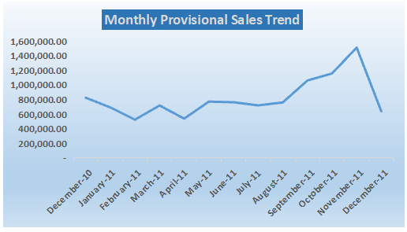
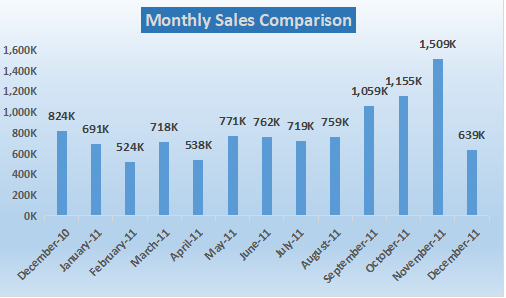
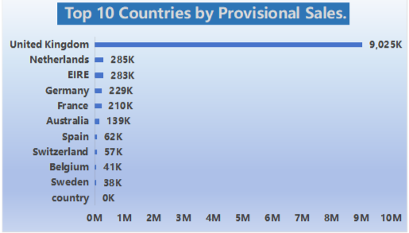
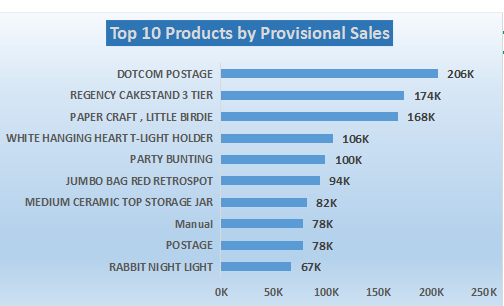
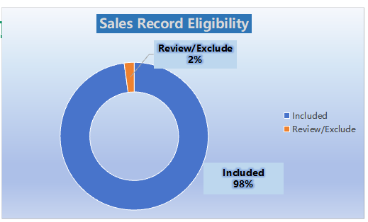
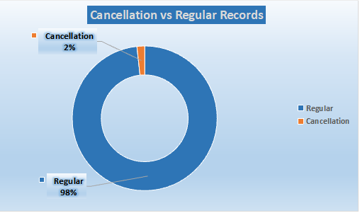

# Retail Sales, Customer & Product Performance Intelligence

A spreadsheet-based data analytics project exploring retail sales performance, monthly trends, geographic markets, product rankings, and transaction data quality using a real-world retail dataset.

## Project Overview

This project analyzes transaction records from a UK-based online retailer to identify sales patterns, understand geographic performance, examine product and service descriptions, and investigate data-quality issues.

The analysis was completed using **WPS Office Spreadsheets**, including spreadsheet formulas, PivotTables, charts, data-quality checks, and an interactive-style dashboard.

The goal was to transform raw transaction data into meaningful business insights and practical recommendations while documenting assumptions and limitations.

## Business Objectives

- Analyze provisional monthly sales performance.
- Identify the leading countries by provisional sales value.
- Rank product and service descriptions by sales value.
- Examine cancellation records and unusual transaction values.
- Assess missing values and repeated transaction combinations.
- Build a dashboard to communicate findings clearly.
- Develop evidence-based business recommendations.

## Dataset

**Dataset:** Online Retail

**Source:** UCI Machine Learning Repository

**Official link:** https://archive.ics.uci.edu/dataset/352/online%2Bretail

**Period:** 1 December 2010 – 9 December 2011

**Size:** 541,909 transaction records

The dataset contains eight original columns:

| Column | Description |
|---|---|
| InvoiceNo | Transaction invoice identifier |
| StockCode | Product or transaction item code |
| Description | Item description |
| Quantity | Quantity recorded for the transaction line |
| InvoiceDate | Transaction date and time |
| UnitPrice | Unit price recorded for the item |
| CustomerID | Customer identifier, where available |
| Country | Customer's country |

The dataset includes cancellation records, missing customer identifiers, and unusual transaction values that require careful interpretation.

**Dataset citation:** Chen, D. (2015). *Online Retail* [Dataset]. UCI Machine Learning Repository. https://doi.org/10.24432/C5BW33

The dataset is distributed under the Creative Commons Attribution 4.0 International (CC BY 4.0) license. Consult the official dataset page for licensing and attribution requirements.

## Tools and Techniques

- WPS Office Spreadsheets
- Spreadsheet formulas and calculated columns
- PivotTables
- Charts and dashboard development
- Missing-value and transaction-quality checks
- Sales eligibility rules
- Business analysis and reporting

## Data Preparation and Quality Checks

The original dataset was preserved, and a separate working sheet was used for analysis.

The project included checks for:

- Missing CustomerID and Description values
- Repeated transaction-key combinations
- Negative quantities and cancellation-prefixed invoices
- Zero and negative unit prices
- Date-range validity
- Calculated line amounts
- Eligibility for provisional sales analysis

Records were flagged for review rather than automatically deleted. A sales eligibility rule was applied to separate records included in provisional sales analysis from records requiring review.

### Key Data Quality Findings

| Check | Result |
|---|---:|
| Records missing CustomerID | 135,080 (24.93%) |
| Records missing Description | 1,454 |
| Cancellation-prefixed invoice records | 9,288 |
| Records with negative quantities | 10,624 |
| Records with zero unit price | 2,515 |
| Records with negative unit price | 2 |

All 9,288 cancellation-prefixed records are included within the 10,624 negative-quantity records. These categories overlap and should not be added together.

The repeated-key investigation identified matching transaction combinations. Repeated combinations were treated as items for review rather than automatically deleted records.

## Key Business Findings

### 1. Geographic Performance

The United Kingdom was the dominant market, with provisional sales of **9,025,226.18**.

**Recommendation:** Investigate the products and transaction patterns driving UK sales. Evaluate other markets using additional evidence before making expansion decisions.

### 2. Monthly Performance

November 2011 recorded the highest provisional monthly sales value among the months shown, at **1,509,496.33**.

**Recommendation:** Examine November's transaction volume and product mix before using the result for future sales planning.

December 2011 is incomplete because the dataset ends on 9 December 2011.

### 3. Product and Service Performance

Postage-related entries ranked highly alongside merchandise. DOTCOM POSTAGE recorded **206,248.77**, while REGENCY CAKESTAND 3 TIER recorded **174,484.74**.

**Recommendation:** Separate postage and service-related entries from physical merchandise before identifying the best-performing products.

### 4. Customer Data Quality

A total of **135,080 records (24.93%)** had missing CustomerID values.

**Recommendation:** Report missing identifiers transparently and restrict customer-level metrics to records with usable customer identifiers.

### 5. Cancellations and Negative Quantities

The analysis identified **9,288 cancellation-prefixed records** and **10,624 records with negative quantities**.

**Recommendation:** Analyze cancellation records and other negative-quantity transactions carefully before finalizing net sales or return-related metrics.

### 6. Pricing Data Quality

A total of **2,515 records** had zero unit prices, while **2 records** had negative unit prices.

**Recommendation:** Investigate zero-price records and accounting adjustments separately, documenting their treatment in sales calculations.

## Dashboard and Visualizations

The workbook includes a dashboard supported by six chart screenshots.

### Monthly Sales Trend



### Monthly Sales Comparison



### Top 10 Countries by Provisional Sales



### Top 10 Products by Provisional Sales



### Sales Record Eligibility



### Cancellation vs. Regular Records



## Sales Calculation and Interpretation

The provisional sales measure includes records marked `Include` by the project's current sales eligibility rule.

The current rule excludes cancellation-prefixed records and records with zero or negative unit prices. It is a working analytical definition, not a verified accounting measure of revenue or profit.

- **Provisional Sales Value:** 10,666,688.64
- **Records Included in Sales Analysis:** 530,104
- **Records Flagged for Review:** 11,805
- **Cancellation Records:** 9,288
- **Cancellation Rate:** 1.71% of source transaction records

The cancellation rate is a record-based measure, not the percentage of unique orders cancelled. The sales measure should not be interpreted as net revenue, profit, or a complete accounting reconciliation.

## Project Structure

```text
Retail_Sales_Customer_Product_Analytics/
├── Analysis/
│   └── Retail_Sales_Customer_Product_Analytics.xlsx
├── Data/
│   └── Online Retail.xlsx
├── Documentation/
│   └── Methodology_and_Data_Quality.md
├── Screenshots/
│   ├── cancellation_vs_regular_records.png
│   ├── monthly_sales_comparison.png
│   ├── monthly_sales_trend.png
│   ├── sales_record_eligibility.png
│   ├── top_10_countries.png
│   └── top_10_products.png
└── README.md
```

The structure above assumes the methodology document has been created and the dataset has been renamed to `Online Retail.xlsx`. Adjust the names if your final files differ.

## Limitations

- The dataset covers approximately one year, which is insufficient to establish recurring seasonal patterns confidently.
- December 2011 is incomplete and should not be compared directly with full months without qualification.
- Missing CustomerID values limit customer-level analysis.
- Product descriptions include postage and service-related entries, so rankings do not represent physical merchandise alone.
- The provisional sales calculation depends on the project's eligibility rule and should not be treated as verified accounting revenue.
- Repeated transaction keys require investigation before deciding whether records are genuine duplicates.
- Zero-price transactions may have legitimate explanations and should not automatically be considered errors.

## Conclusion

This project demonstrates practical spreadsheet-based data analysis, data-quality investigation, PivotTable reporting, chart development, dashboard design, and evidence-based business recommendations using a real-world retail dataset.

It emphasizes transparent assumptions, preservation of source records, and cautious interpretation of business results.

## Author

**Nasir Aziz**

